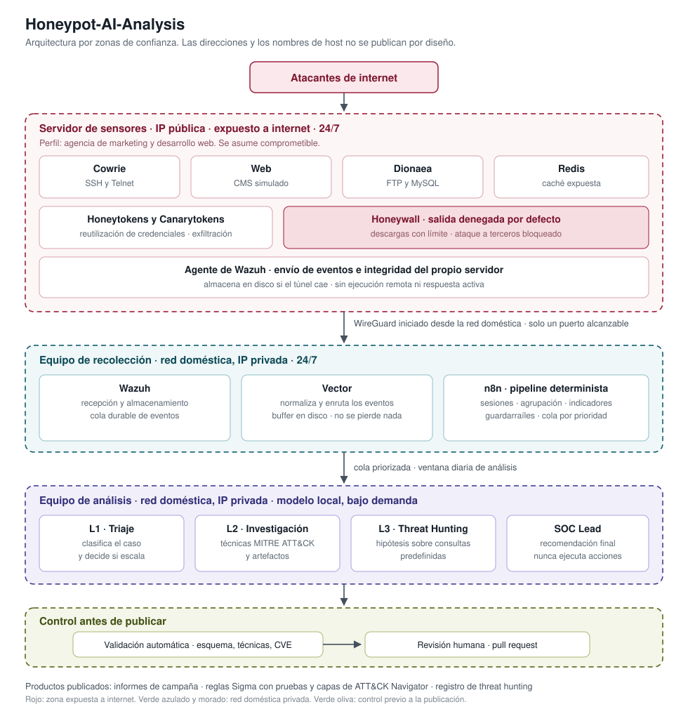

# Honeypot-AI-Analysis — De honeypots expuestos a inteligencia de amenazas

> Un laboratorio de inteligencia de amenazas construido desde cero sobre honeypots expuestos a
> internet, para capturar actividad real de atacantes oportunistas y convertirla en informes de
> campaña y reglas de detección. Los sensores simulan el servidor de una pyme, un pipeline
> determinista construye los casos y un modelo de lenguaje local asiste en la investigación y en
> el threat hunting sin ejecutar ninguna acción. Como la entrada la escribe el adversario, el
> propio agente se trata como superficie de ataque y se somete a pruebas adversarias continuas.

*An internet-facing honeypot lab that turns real opportunistic attacker activity into threat
intelligence and detection rules. A deterministic pipeline builds the cases; a locally-hosted
LLM assists with investigation and threat hunting without ever acting on its own. Documentation
is written in Spanish.*

## Por qué este proyecto

Los compromisos que sufre una empresa pequeña no suelen empezar con un ataque dirigido, sino con
un servidor expuesto que alguien encuentra escaneando internet de forma indiscriminada. Esa
actividad es abundante y está poco documentada desde la perspectiva de quien la recibe. Leer
informes sobre ella no es lo mismo que verla llegar.

Hay un segundo motivo. Procesar registros escritos por un atacante con un modelo de lenguaje
convierte al propio modelo en superficie de ataque, y ese problema todavía tiene poca
documentación pública con datos propios.

| Disciplina | Qué practico |
|---|---|
| Seguridad de sistemas con IA | Endurecer un agente cuya entrada la escribe el adversario y someterlo a pruebas adversarias |
| Inteligencia de amenazas | Requisitos antes de recolectar, agrupación por comportamiento, indicadores con ciclo de vida |
| Análisis forense | Reconstruir qué ocurrió en cada sesión; los informes del modelo son el borrador, la revisión es la verificación |
| Ingeniería de ciberseguridad | Infraestructura expuesta: segmentación, control de salida, infraestructura como código |

## Qué voy a hacer

1. **Definir** los requisitos de inteligencia antes de recolectar un solo evento.
2. **Construir** el laboratorio completo en local, replicando el servidor de producción.
3. **Desplegar** cuatro honeypots coherentes con una pyme ficticia en un servidor expuesto.
4. **Procesar** lo capturado con un pipeline determinista y un modelo local que solo recomienda.
5. **Publicar** informes de campaña, reglas de detección validadas y registro de threat hunting.

## Arquitectura

Cuatro zonas con niveles de confianza distintos. Los datos fluyen en una sola dirección, de la
menos confiable a la más protegida, y cada frontera impone sus propias restricciones.

El **servidor de sensores** tiene IP pública y se asume comprometible: es la máquina que se
quiere que ataquen. Sus eventos viajan por un túnel WireGuard que se inicia desde casa, nunca al
revés, y que solo deja alcanzable un puerto del **equipo de recolección**, donde Wazuh almacena,
Vector normaliza y n8n construye los casos. El **equipo de análisis** ejecuta el modelo bajo
demanda y no tiene ruta desde la zona expuesta. Nada se publica sin validación automática y
revisión humana.



## Sensores

Perfil: una **agencia de marketing y desarrollo web** que administra su propio servidor. Justifica
los servicios expuestos sin que la combinación delate un señuelo.

| Servicio | Herramienta | Qué captura |
|---|---|---|
| SSH y Telnet | Cowrie | Credenciales, comandos, persistencia y cargas descargadas |
| Web | Honeypot propio | Explotación de vulnerabilidades conocidas y escaneo |
| FTP y MySQL | Dionaea | Subida de ficheros y abuso de bases de datos |
| Caché | Honeypot de Redis | Cadenas de explotación orientadas a minería |
| Credenciales sembradas | Honeytokens y Canarytokens | Reutilización entre servicios y exfiltración confirmada |

## Seguridad

Este repositorio **no publica direcciones IP, dominios ni nombres de host**. Publicar la
dirección de un señuelo permite identificarlo, evitarlo o atacarlo de forma dirigida.

| Control | Qué impide |
|---|---|
| Túnel iniciado desde la red doméstica | El servidor expuesto no puede alcanzar el extremo privado |
| Un solo puerto alcanzable desde el túnel | Nada más de la red doméstica queda expuesto |
| Agente sin ejecución remota ni respuesta activa | Comprometer el servidor no permite ordenar nada al recolector |
| Honeywall con salida denegada por defecto | El señuelo no puede usarse para atacar a terceros |
| Infraestructura como código | Reconstrucción completa y cronometrada tras un compromiso |
| El modelo nunca ejecuta ni publica | Una inyección produce, como mucho, un análisis erróneo |
| Guardarraíles e indicadores fuera del modelo | Reglas críticas y extracción de indicadores son deterministas |
| Revisión humana obligatoria | Nada se publica sin aprobación |

## Qué preguntas responde

| | Pregunta |
|---|---|
| PIR-1 | Qué hacen los bots en los primeros minutos tras conseguir acceso por SSH |
| PIR-2 | Cuánto tarda una vulnerabilidad web en explotarse desde que se publica |
| PIR-3 | Qué credenciales entran en circulación y cómo se reutilizan entre servicios |
| PIR-4 | Cómo se despliegan las campañas de minería contra servicios expuestos |
| PIR-5 | Si existen intentos de inyección dirigidos a agentes de IA en el tráfico oportunista |

## Qué no hace

- **No atribuye** actividad a actores ni a grupos. Agrupa campañas por comportamiento observado.
- **No ejecuta** malware. Captura muestras y consulta sus hashes.
- **No busca** ataques dirigidos ni APTs. El alcance es la amenaza oportunista.
- **No publica** nada decidido por un modelo sin revisión humana.

## Pila tecnológica

| Capa | Herramientas |
|---|---|
| Sensores | Cowrie, Dionaea, honeypot web propio, honeypot de Redis |
| Cebos | Honeytokens propios, Canarytokens |
| Control de salida | nftables sobre `DOCKER-USER` |
| Transporte | WireGuard, agente de Wazuh |
| Recolección | Wazuh, Vector |
| Orquestación | n8n sobre PostgreSQL |
| Enriquecimiento | GreyNoise, AbuseIPDB, VirusTotal |
| Análisis | Modelo de lenguaje local sobre llama.cpp |
| Detección | Sigma, MITRE ATT&CK, ATT&CK Navigator |
| Infraestructura | Docker Compose, Ansible, cloud-init |
| Integración continua | GitHub Actions |

## Fases

| Fase | Contenido | Documentación |
|---|---|---|
| 0 | Gobierno, requisitos y modelo de amenazas | `docs/01-concepto/` |
| 1 | Laboratorio espejo e infraestructura base | `docs/02-arquitectura/` |
| 2 | Sensores, cebos y pruebas de realismo | `docs/02-arquitectura/` |
| 3 | Pipeline determinista y línea base | `docs/04-metodologia/` |
| 4 | Capa de IA, evaluación y pruebas adversarias | `docs/05-ai-security/` |
| 5 | Productos y detección como código | `docs/07-detecciones/` |
| 6 | Despliegue escalonado en el servidor | `docs/02-arquitectura/` |
| 7 | Periodo de observación y primer informe | `docs/06-productos/` |

## Estructura del repositorio

```
├── docs/
│   ├── 01-concepto/                  <======   Working On
│   ├── 02-arquitectura/   
│   ├── 03-decisiones/     
│   ├── 04-metodologia/     
│   ├── 05-ai-security/    
│   ├── 06-productos/       
│   ├── 07-detecciones/   
│   ├── 08-hallazgos/       
│   └── diario.md          
├── infra/                  
├── pipeline/               
├── rules/                  
└── tests/                 
```

## Autor

**Daniel Bandarica** — [LinkedIn](https://linkedin.com/in/danielbandarica) ·
[GitHub](https://github.com/DanielBandarica02) · [TryHackMe](https://tryhackme.com/p/daN1)
